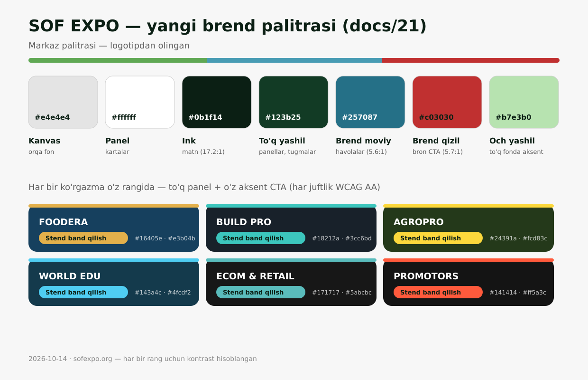

# 21 · UI auditi: brend ranglari va vizual muammolar (2026-10-14)

Sana: 2026-10-14 · Holat: **tuzatishlar bajarildi** (2026-10-14, §8) · Buyurtma: buyurtmachining
"Sayt UI'ida kamchiliklar ko'p — menu, ranglar, boshqa joylar" degan fikri bo'yicha.
Yo'nalish (buyurtmachi): **asosiy sayt SOF EXPO ranglaridan kelib chiqib, har bir ko'rgazma
o'zining ranglarida**. CTA qarori (buyurtmachi): **aralash** — markazda qizil, ko'rgazmada
o'z aksenti.

## 0. Qanday tekshirildi

| Nima | Qanday |
|---|---|
| Ildiz tokenlari va palitra | `src/styles/global.css :root`, `redesign.css`, `premium.css` qatlam-qatlam o'qildi |
| Ko'rgazma-po-rang mexanizmi | `src/data/brands.ts` (`brandCss()`), `brand-map.json`, `Base.astro:210` |
| Qattiq kodlangan ranglar | `grep "#xxxxxx"` bo'yicha barcha `.astro/.ts` fayllar — token tizimini chetlab o'tuvchi har bir topilma |
| Menyu | `Header.astro` (mega-menyu + mobil akkordeon), `redesign.css:115-420` |
| Render natijasi | dev-serverdan `/uz/`, `/ru/`, `/ru/events/foodera-expo/` kabi sahifalar `curl` bilan olib tahlil qilindi |
| Kontrast | WCAG luminance hisob-kitobi har bir taklif etiladigan juftga (§4); `scripts/check-brand-contrast.mjs` — hozir 6/6 ko'rgazma ✓ |

> Eslatma: sandbox'da brauzer o'rnatib bo'lmadi (tarmoq cheklovi), shuning uchun skrinshot
> emas, kod + render-HTML tahlili. Vizual yakuniy tekshiruv jonli preview'da birga qilinadi.

## 1. Yaxshi yangilik: karkas tayyor

- Sayt token asosida: `brandCss()` bitta blok chiqaradi — barcha komponent shu tokenlarni
  o'qiydi. Ya'ni palitrani almashtirish uchun 647 sahifani qayta yozish shart emas.
- 6 ko'rgazmaning palitralari `brand-map.json`'da bor; ko'rgazma sahifasi
  `data-brand="…"` orqali o'z ranglarini oladi; kalendar va bosh sahifa kartalarida har
  bir qatorning belgisi ko'rgazmaning o'z rangida (`--ic`, `showColor()`).
- Logotip ranglaridagi uch rangli chiziq (`--brand-stripe`) ko'rgazma hero'si tepasida va
  footer'da bor (`redesign.css:1299`, `global.css:1539`).

Muammo shundaki, **markazning o'z palitrasi hozir brend hech qayerda ko'rinmaydi** va
qattiq kodlangan ranglar ko'rgazma sahifalarida brendni buzadi.

## 2. Topilgan muammolar

### A. Markaz SOF EXPO ranglarida emas `[taklif — asosiy o'zgarish]`

| # | Muammo | Manba |
|---|---|---|
| A1 | Ildiz palitrası: kulrang kanvas `#E4E4E4`, qora, ko'k `#0063E4`, nordon-sariq `#F4FD10`. Logotipdagi yashil/moviy/qizil faqat footer'dagi 6 px chiziqda va logonun o'zida qolgan — butun sahifa bo'ylab brend hissi yo'q | `global.css:20-56` |
| A2 | Mobil brauzer tepasining `theme-color` = eski to'q yashil `#0f2b1c` — hozirgi kulrang kanvas bilan ham uyg'un emas | `Base.astro:155` |

### B. Ko'rgazma sahifasida brend rangi sinadigan joylar `[xato]`

| # | Muammo | Ko'rinishi | Manba |
|---|---|---|---|
| B1 | CTA hover `#e2eb00` — qattiq nordon-sariq: FOODERA (tan) yoki AGROPRO Cta'ini hover qilsangiz brend rangi "chaqnab" eski sariqqa o'zgaradi | har hover'da ko'zga tashlanadi | `redesign.css:485`, `Blocks.astro:573`, `index.astro:552` |
| B2 | `#0052bd` to'q ko'k statistika paneli — bosh sahifadagi "Nega Samarqand" raqamlari markaz ko'kiga mixlangan | subdomain-build'da ko'rgazma rangini buzadi | `index.astro:978-982` |
| B3 | Och-yashil fonlar `#f2f7f3`, `#e7efe8` — eski "yashil sayt" qoldig'i: kviz forma, holat xabarlari | FOODERA/BUILDPRO sahifasida yashilimtir dog'lar | `QuizForm.astro:586,695,766`, `FormHandler.astro:181-183` |
| B4 | `#08160e` to'q yashil — 3D-tour ramkasi | brend panellarida yashil | `Blocks.astro:514-515` |
| B5 | Soha ranglari `INDUSTRY_COLOR` — eski palitradagi o'lik yashil/bronza; `company: #0f2b1c` umuman eski evergreen | kalendar/chiplarda eski ohang | `labels.ts:31-40` |
| B6 | `.btn--accent:hover { #c5903a }` eski bronza qoidasi — redesign uni qoplagan (o'lik), lekin formali kod aralashuv keltiradi | — | `global.css:474`, `premium.css:17-18` |
| B7 | FOODERA "asosiy tugma oltin" bo'lishi kerak edi (docs/19 §3), amalda `--accent = #c9a874` (sovuq tan). Brendga yaqinroq yorqin oltin taklif qilinadi | CTA xira | `brand-map.json` → taklif §4 |

### C. Menyu `[kichik / tekshiruv]`

| # | Muammo | Manba |
|---|---|---|
| C1 | Mega-menyu faqat `hover`/klaviatura bilan ochiladi: sensor ekranli noutbukda (≥1280px) birinchi bosish panelni ochmay, darhol sahifaga o'tadi | `Header.astro` `nav__link` — click-toggle yo'q |
| C2 | `mega__links` kartalari qattiq `#f5f5f5/#ececec` — ko'rgazma sahifasida ham xuddi shu kulrang (kritik emas, tokenlash mumkin) | `redesign.css:330,336` |
| C3 | 1280–1439px oraliqda qidiruv tugmasi yashiriladi — hujjatli qaror, lekin 5 tilda pill-lar sig'ishini preview'da qayta ko'ramiz | `redesign.css:249-266` |

### D. Bosh sahifa va boshqa joylar `[kichik]`

| # | Muammo | Manba |
|---|---|---|
| D1 | ~~`a:hover .arr`~~ — tekshiruvda o'rtoqlik xato deb topilgan edi, lekin selektor faqat **hover qilingan havolaning ichidagi** strelkaga ta'sir qiladi (karta doirasida) — xato emas, o'zgartirilmadi | — |
| D2 | Bosh sahifadagi qattiq kulrang/qora qoldiqlar (`#1a1a1a`, `#f5f5f5`, `#e2eb00`) — markazda muammo emas, lekin host-build'da rang sinadi | `index.astro:514,906,1094` |
| D3 | `stickyCtaBar` Telegram/WhatsApp mavii-yashilligi — xizmat brendlari, to'g'ri | o'zgartirilmaydi |

## 3. E'tiborga molik: sariq CTA

`#F4FD10` oq kanvasda 1.11:1 — grafik aksent sifatida deyarli ko'rinmaydi, u faqat
"qora matnli tugma" bo'lib ishlaydi. 2026-10 dizaynida u "stend band qilish"ning
signal-rangi edi. Brendga o'tishda ikki yo'l bor (bo'lim 4, tasdiq kerak).

## 4. Taklif qilinadigan yangi palitra (logotipdan)

Yondashuv: **kanvas neytral qoladi** (kulrang-oq panellar — "AI-нагенеренный pastel dizayn"
ga qaytmaslik uchun, docs/18 §2), brend ranglari esa matn, tugma, havola va belgi
chiziqlariga kirib keladi:

| Token | Hozir | Taklif | Kontrast | Izoh |
|---|---|---|---|---|
| `--ink` | `#0A0A0A` | `#0B1F14` | 17.2:1 oqda | yashil-qora — matn |
| `--evergreen` (qora panel, footer, birlamchi tugma) | `#0A0A0A` | `#123B25` → hover `#1B4D2E` | oq matn 12.5 / 9.8:1 | brend to'q yashili |
| `--moss`/`--gold` (havola, fokus, aksent chiziq) | `#0063E4` | `#257087` | 5.6:1 oqda (AA) | logotip moviyining to'q nusxasi; dekorativ joylarda asl `#489CB4` |
| `--accent` (bron CTA) | `#F4FD10` | `#C03030` + oq matn, hover `#A52828` | 5.7 / 7.2:1 | **logotip qizili** (variant: sariqni saqlash) |
| `--gold-soft` (to'q fondagi och aksent) | `#F4FD10` | `#B7E3B0` | 12.0:1 to'qda | och yashil |
| `--brand-stripe` | yashil/moviy/qizil | o'zgarishsiz, kengayadi | — | §5 |
| `--danger` | `#C4320A` | o'zgarishsiz | — | brend qizilidan farqli ohangda qoladi |

Bir qarashda palitra: 

Ko'rgazma palitralari o'zgarmaydi (logotipdan tayyor, contrast-test yashil) — faqat
§2-B qattiq ranglari tokenlarga almashtiriladi va hover `color-mix(in srgb,
var(--accent) 85%, #000)` bilan har brendda to'g'ri ishlaydi. FOODERA `goldSoft` uchun
yorqinroq oltin varianti taklif qilinadi (`#c9a874` → amalda `#E3B04B` tanlandi; §8,
kontrast-skript tekshiradi).

## 5. Brend imzo-chizig'ini kengaytirish

Uch rangli `--brand-stripe` hozir faqat: ko'rgazma hero tepasi + footer tepasi.
Taklif (markaz sahifalarida brend "ovozi"):

1. Hero H1 ostiga qisqa uch rangli chiziq (bosh sahifa + bo'lim hero'lari);
2. `.evnav` tagiga yana chiziq (hozir redesign uni o'chirgan — faqat `main > .evnav`,
   markaz hostida yo'q, tekshiriladi);
3. "Keyingi ko'rgazma" qora kartasi va CTA bandi tepasiga nozik chiziq;
4. Footer — bor (saqlanadi).

## 6. Ish rejasi (tasdiqlangach)

| Bosqich | Ish | Tekshiruv |
|---|---|---|
| 1 | Ildiz tokenlarini §4 bo'yicha almashtirish (`global.css :root` + `--accent` matn-rangi ishlarini sozlash: `.btn--accent` matn `--ink` → oq) | build + kontrast hisobi |
| 2 | §2-B qattiq ranglar → token/showColor (`#e2eb00` hoverlar, `#0052bd`, och-yashillar, `labels.ts`, `theme-color`) | `check-brand-contrast.mjs` |
| 3 | Brend chizig'ini §5 bo'yicha kengaytirish | preview |
| 4 | Menyu: C1 click-toggle (ixtiyoriy), C2 tokenlash, har bir bo'lim pill'ini 5 tilda ko'z bilan tekshirish | preview |
| 5 | `npm run build` + unit-testlar + SEO/tarjima auditlari yashil saqlansin | CI bilan bir xil |

Chegaralar: sahifa tuzilishi (bo'limlar tartibi) o'zgarmaydi; matnlar/kalit so'zlar
tegilmaydi (SEO gate buzilmasligi uchun); Telegram/WhatsApp ranglari o'zgarishsiz.

## 8. Bajarilgan ishlar (2026-10-14)

Buyurtmachi qarori: **aralash** — markazda qizil CTA, ko'rgazmada o'z aksenti; ishga ruxsat berildi.

### 1-bosqich — palitra (bajarildi)

- Ildiz tokenlari brendga o'tkazildi (`global.css :root`): ink `#0B1F14`, panel/tugma
  yashili `#123B25` (hover `#1B4D2E`), havola-moviy `#257087`, CTA-qizil `#C03030`,
  to'q fondagi och aksent `#B7E3B0`. Yangi `--accent-ink` tokeni (markazda oq) —
  endi aksent foni bilan matn hech qachon "sinmaydi".
- `brandCss()` har bir ko'rgazma uchun `--accent-ink:<o'z ink'i>` va
  `--accent-soft:<cream2>` chiqaradi — ko'rgazma sahifasining aksenti o'z rangida,
  ustidagi matn esa AA-bojuftlig'ida (`brands.ts`).
- FOODERA aksenti sovuq tan `#C9A874` → haqiqiy oltin `#E3B04B` (ink 8.2:1,
  to'q fonda 5.5:1 — `check-brand-contrast` yashil) (`brand-map.json`).
- `theme-color` markaz: `#0F2B1C` (eski) → `#123B25` (`Base.astro:155`).

### 2-bosqich — qattiq ranglar tokenlash (bajarildi)

- `#E2EB00` hoverlar o'chirildi → `color-mix(in srgb, var(--accent) 85%, #000)`
  (`redesign.css`, `index.astro .h-go`, `Blocks.astro .cta-inline`) — endi hover
  har bir sahifada o'sha sahifaning rangidir.
- `#0052BD` statistika paneli → `var(--gold-ink)`; och-yashil `#F2F7F3`/`#E7EFE8` →
  brend-tintili `color-mix(...)` (`QuizForm`, `FormHandler`); `#08160E` →
  `var(--evergreen)` (3D-tour); `labels.ts` company `#0F2B1C` → `#123B25`;
  `.bt--accent` `--btn-fg #1D1204` → `var(--accent-ink)`; o'lik bronza hover
  (`#C5903A`) `global.css` va `premium.css`dan olib tashlandi; `motion.css`
  bronza shafaq (`rgba(200,136,44)` → aksentga bog'landi).
- Aksent fonda matn endi hamma yerda `--accent-ink`: strelka-doira hover (`.arr`),
  `.btn--accent`, `.btn--light:hover`, `.chip--gold`, footer CTA strelkasi,
  `.ev__more:hover`, `.pill--w:hover`, kalendar "ochiq" pill'i va sana plitasi hover,
  `.callout--gold` ichki matnlari.
- Footer havola hoveri `var(--accent)` → `var(--gold-soft)` — qizil matn to'q yashil
  footerda kontrastdan yiqilardi.

### 3-bosqich — imzo-chizig'i kengaytmasi (bajarildi)

- `.hero::before` — barcha bo'lim hero'lari (ichki sahifalar) tepasida 6 px tricolor
  (ko'rgazma sahifalarida o'z bandi, avvalgidek `data-brand` orqali).
- Bosh sahifa hero H1 ostiga `"brandrule"` — 96 px uch rangli chiziq.
- "Keyingi ko'rgazma" qora kartasi endi **shu ko'rgazmaning o'z bandini** tashiydi:
  kartaga inline `--brand-stripe: <show stripe>` (FOODERA = moviy/oltin).
- `.cta-band` (ichki sahifalardagi to'q CTA) tepasida 6 px band.
- Footer'dagi chiziq saqlanib qoldi.

### 4-bosqich — menyu (bajarildi)

- Escape tugmasi mega-menyuni haqiqatda yopmaydigan xato: skript `data-keyboard-open` va
  `data-dismissed` atributlarini yozardi, lekin ularga CSS qoidasi yo'q edi — Escape
  faqat fokusni siljitardi, panel ochiq qolardi. Endi ikkala atribut haqiqiy ko'rinish
  holatini boshqaradi (`global.css`).
- Sensor ekranlarda (touch-first, `hover: none`) birinchi tap mega-panelni **ochadi**,
  ikkinchi tap sahifaga o'tadi; tashqariga tegilganda yopiladi. Havolalarga
  `aria-haspopup`/`aria-expanded` qo'shildi.
- Mega-menyu link kartalari `#F5F5F5`/`#ECECEC` → `var(--cream-2)`/`var(--line)`.

### 5-bosqich — tekshiruvlar

- `npm run build` ✓ (630 sahifa + OG kartalari)
- `npm test` ✓ 91/91
- `check-brand-contrast.mjs` ✓ 6/6 ko'rgazma AA
- SEO audit ✓ 0 muammo; page-audit ✓; kalit so'z gate A≥70 ✓
- Render tekshiruvi (dist): FOODERA `--accent:#E3B04B` + `accent-ink:#12222E`;
  markaz `theme-color #123B25`; `.h-show::before` + inline `--brand-stripe` FOODERA
  band bilan kompilyatsiyada bor.

### 6-bosqich — ikkinchi o'tkazuv (bajarildi, 2026-10-14)

Auditdan keyingi toza "sweep"da topilgan qolgan qattiq ranglar:

| Joy | Eski | Yangi |
|---|---|---|
| `SponsorForm` paneli | bej/oltin yuvinish `#FEF9EC/#F0D9A8` | `color-mix(var(--moss) 6/18%)` — har sahifada o'z ohangida |
| `VisitorForm` paneli | `#F8FAF8` gradient | `var(--cream-2)` |
| `CallbackForm` "onlayn" nuqtasi | Tailwind-yashil `#22C55E` | `var(--success)` + shaffof halqa |
| `TeamWall` portret foni | off-palitra navy `#0A1F3D` | `var(--evergreen)` |
| `PartnerLogoWall` mehmonxona plitkasi | `#EEF1EC` | `var(--accent-soft)` |
| Header desktop CTA tugmasi | `.btn` (to'q) | `.btn--accent` — markazda qizil, ko'rgazmada o'z aksenti (mobil menyu bilan bir xil) |

Shuningdek mijoz uchun bir varaqli ko'rgazma: `docs/assets/21-brand-palette.png`
(markaz 7 tokeni + 6 ko'rgazmaning panel/aksent juftliklari, SVG→PNG, aniq ranglar).

Tekshiruvlar 6-bosqichdan keyin ham yashil: build ✓ · 91/91 test ✓ · kontrast 6/6 ✓.

## 9. Vizual tekshiruv (7-bosqich, bajarildi 2026-10-14)

Foydalanuvchi preview'da \"desktopda buzilishlar va mobilga o'tishda muammolar\" deb
xabar bergach, headless Chromium (Sparticuz build, npm tarbosti orqali) bilan
jonli `astro preview` skrinshotlar olib tekshirildi:

| Tekshirilgan | Natija |
|---|---|
| Bosh sahifa 1440 / 1280 / 1100 / 768 / 390, fullPage | toza — menyu kollapsi to'g'ri, gorizontal skroll yo'q |
| Mega-menyu ochiq, mobil menyu ochiq | toza |
| events / news / packages / tickets / search / contacts / about / venue @1440–390 | toza |
| FOODERA va AGROPRO sahifalari (o'z brend ranglari) | to'g'ri: FOODERA moviy/zargar, AGROPRO yashil/sariq, header aksent bosma-bos kelayotir |
| Avtomatik audit (barcha 13 sahifa × o'lchamlar): gorizontal to'planish, ko'rinmay qolgan kontent, konsol xatolari | 0 haqiqiy nuqson (jadval skrolli va `.ev__tagline` line-clamp — rejalashtirilgan xatti-harakat) |

**Topilgan yagona real nuqson — scroll-reveal kechikishi.** Tez skrollda yoki
sahifa o'rtasiga sakrashda bo'limlar 620 ms davomida to'liq shaffof, bolalar
animatsiyasi esa ~1,4 s gacha cho'zilardi — sahifada katta \"bo'sh kulrang zonalar\"
paydo bo'lardi. Bu hujjatlardagi dizayn qoidasiga (docs/07 §8: sokin 200 ms
kirish) ham zid edi. Tuzatish:

- `global.css .reveal-pending`: 620 ms/18px → **200 ms/8px** (hujjatlagan
  qiymatga qaytarildi);
- `motion.css` stagger: 700 ms → **240 ms**, ketma-ketlik 70 ms → 35 ms,
  bazaviy kechikish 120 ms → 40 ms (oxirgi bola ≈0,56 s ichida ko'rinadi);
- `Base.astro` IntersectionObserver: `rootMargin -8% → +12%`, threshold
  0.05 → 0.01 — bo'lim viewportga kirishdan **oldinroq** reveal bo'ladi,
  foydalanuvchi hech qachon bo'sh zonani ko'rmaydi (JS'siz/print/reduced-motion
  xavfsizliklari o'zgarmadi).

Tekshiruv: build ✓ · 91/91 test ✓ · sakrash-skrinshotlarda barcha bo'limlar
800 ms ichida opacity=1 ✓.

## 10. Qolgan kuzatuvlar (keyingi qadamga)

- C3 (1280–1439px da menyu sig'ishi) — hujjatli skript chegarasi; preview'da ZH/TR
  yorliqlari bilan qayta ko'riladi (1440 da sig'adi, 1100 da burgerga o'tadi).
